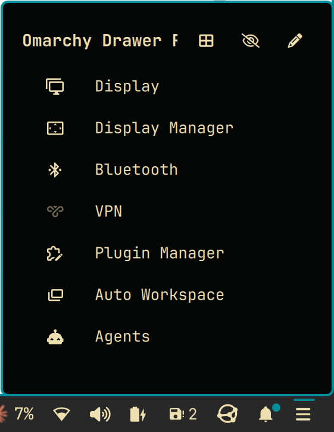

# Omarchy Drawer Redux

Collapse the bar widgets you rarely need into one drawer button, without
disabling them. Pick a widget from the drawer and its own panel opens right
under the button.



This is the maintained continuation of
[Plugin Drawer](https://github.com/alyayman921/UNMAINTAINED-Omarchy-drawer) by
Aly Sarhan, which is no longer maintained. It has not had a release yet.

## What it does

- Hides any bar widget in a compact drawer without disabling it.
- Shows hidden widgets in a grid with previews, or in a compact list.
- Reorders them by drag and drop.
- Moves widgets between the bar and the drawer from an edit view.

## Requirements

Omarchy 4.0.6 or newer. Nothing else.

## Install

```sh
omarchy plugin add https://github.com/huey-holdings-llc/omarchy-drawer-redux --enable
```

## Update

```sh
omarchy plugin update io.github.huey-holdings-llc.omarchy-drawer-redux
```

## Remove

Move your widgets back to the bar from the edit view first, because a widget
listed in the drawer does not appear anywhere once the drawer is gone. Then:

```sh
omarchy plugin remove io.github.huey-holdings-llc.omarchy-drawer-redux
```

## Use

- Left-click the drawer button to open or close it.
- Click an entry to open that widget's panel.
- Click the pen icon to choose which widgets live in the drawer.
- With the drawer open, arrows or `hjkl` move, Enter opens, Esc closes.
- To open it from a hotkey, bind
  `omarchy-shell shell toggle io.github.huey-holdings-llc.omarchy-drawer-redux`.

## What it changes

Moving widgets edits `~/.config/omarchy/shell.json`, and only when you leave the
edit view with changes. Omarchy has no command for this, so the drawer does one
atomic write and keeps the previous file as `shell.json.drawer-backup`. A
widget's bar settings travel with it. A third-party widget also gets an entry in
`plugins`, which keeps it loaded while it is off the bar.

## Known limitations

- Moving a widget back to the bar puts it next to the drawer, not in its old
  spot.
- A widget with several instances on the bar, like a spacer, stays on the bar.
- A third-party widget that needs its own service may not work from the drawer.
  Keep those on the bar.

## Development

See [CONTRIBUTING.md](CONTRIBUTING.md). Lint with `bash tests/lint.sh`, and
deploy a checkout with `scripts/dev-sync.sh --enable`.

## Say thanks

Omarchy Drawer Redux is free and always will be. If it saved you some time and
you feel like it, you can
[buy us a coffee](https://buymeacoffee.com/hueyholdings). No pressure, no
perks, no tiers.

## License

MIT, see [LICENSE](LICENSE). Original work by Aly Sarhan, see
[THIRD-PARTY.md](THIRD-PARTY.md).
