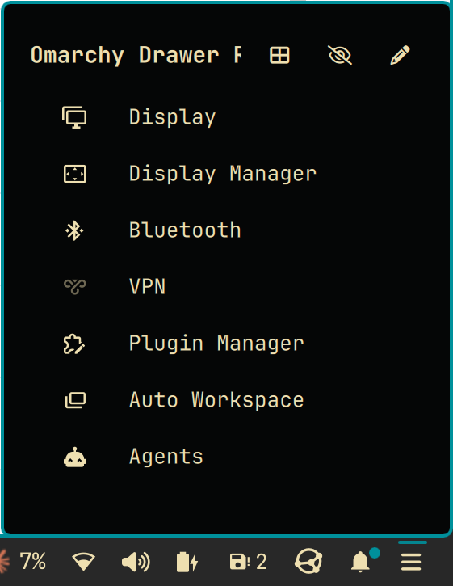

# Omarchy Drawer Redux

Collapse the bar widgets you rarely need into one drawer button, without
disabling them. Pick a widget from the drawer and its own panel opens right
under the button.

> [!NOTE]
> **Omarchy 4.5 does this natively.** Drag a widget into the bar's tray section
> and it lives in the tray drawer, behind the chevron, still running. For most
> people that makes this plugin redundant. Drawer Redux still works on 4.5 and
> keeps its click-to-open panel with grid and list views, but expect it to move
> into maintenance mode. See [Moving to the native drawer](#moving-to-the-native-drawer).



This is the maintained continuation of
[Plugin Drawer](https://github.com/alyayman921/UNMAINTAINED-Omarchy-drawer) by
Aly Sarhan, which is no longer maintained.

## What it does

- Moves bar widgets into a click-to-open panel, where they keep running.
- Shows hidden widgets in a grid with previews, or in a compact list.
- Reorders them by drag and drop.
- Moves widgets between the bar and the drawer from an edit view.

## Requirements

Omarchy 4.0.6 or 4.5.0.

## Install

```sh
omarchy plugin add https://github.com/huey-holdings-llc/omarchy-drawer-redux --enable
```

## Update

```sh
omarchy plugin update io.github.huey-holdings-llc.omarchy-drawer-redux
```

## Remove

Move your widgets back to the bar from the edit view first. The drawer's list
and the widgets' saved bar settings live on the drawer's own bar entry, so
`omarchy plugin disable` or `remove` on the drawer deletes them, and those
widgets end up nowhere. Then:

```sh
omarchy plugin remove io.github.huey-holdings-llc.omarchy-drawer-redux
```

## Use

- Left-click the drawer button to open or close it.
- Click an entry to open that widget's panel.
- Click the pen icon to choose which widgets live in the drawer.
- With the drawer open, arrows or `hjkl` move, Enter opens, Esc closes.
- To open it from a hotkey, bind
  `omarchy-shell shell toggle io.github.huey-holdings-llc.omarchy-drawer-redux`.

## What it changes

Everything is stored in `~/.config/omarchy/shell.json`.

- View mode, grid size, order and hidden widgets are saved on the drawer's own
  bar entry when you change them.
- Moving widgets happens only when you leave the edit view with changes. Omarchy
  has no command for this, so the drawer does one atomic write and keeps the
  previous file as `shell.json.drawer-backup`. A third-party widget gets an entry
  in `plugins` while it is in the drawer, which keeps it loaded.

## Known limitations

A widget in the drawer is not on the bar, and Omarchy treats it that way:

- Panel hotkeys such as `Super+Ctrl+A` for audio stop working for it.
- Only widgets with a panel are useful here. System Update, Microphone, Tray,
  Workspaces and others like them do nothing from the drawer, so keep them on
  the bar.
- It reads its bar settings but cannot save changes to them. A clock format you
  switch inside the drawer goes back on restart.
- It runs with the drawer's permissions, so features that call other shell
  panels, such as the network panel's Wi-Fi QR code, may not respond, and a
  third-party widget that needs its own service may not work. Keep those on the
  bar.

Also:

- `omarchy plugin list` shows a widget in the drawer as disabled.
- Moving a widget back puts it next to the drawer, not in its old spot.
- A widget with several instances on the bar, like a spacer, is not offered.
- If you remove a plugin while its widget is in the drawer, the edit view keeps
  an inert row for it.

## Troubleshooting

- **A widget is missing from the drawer.** Check it is still installed with
  `omarchy plugin list`. If it is also on the bar, the bar copy wins.
- **A widget is nowhere after disabling the drawer.** Run
  `omarchy plugin disable <id>`, then `omarchy plugin enable <id>`. A built-in
  widget only needs the enable.
- **A move failed.** A notification says so and `shell.json` is unchanged. Try
  again: this usually means Omarchy wrote the file at the same moment.
- **The bar looks wrong after a move.** Copy `shell.json.drawer-backup` over
  `shell.json`.

## Roadmap

- Tested on Omarchy 4.5.0. Its native tray drawer covers the core job of this
  plugin, hiding bar widgets without disabling them.
- What only Drawer Redux has: a click-to-open panel under its button, with grid
  previews and a compact list.
- The plan is maintenance mode: fixes if an Omarchy update breaks it, no new
  features. If the native drawer turns out to cover everything, the plugin will
  be deprecated and its marketplace listing withdrawn.
- The drawer relies on Omarchy internals that have no stability promise, so an
  Omarchy update could break it. A fix or a clear notice will follow if it does.

## Moving to the native drawer

1. Open the drawer's edit view (pen icon) and move every widget back to the bar.
2. Remove the drawer:
   `omarchy plugin remove io.github.huey-holdings-llc.omarchy-drawer-redux`
3. Drag the widgets you want tucked away into the bar's tray section, next to
   the system tray. Hover the chevron to show them.

## Privacy

The drawer makes no network connections and collects nothing. Previews stay in
memory.

## About

Maintained by Huey Holdings LLC. This code is written with AI assistance
(Claude), and reviewed and tested by a person on a daily-driver Omarchy machine.

## Development

See [CONTRIBUTING.md](CONTRIBUTING.md). Lint with `bash tests/lint.sh`, and
deploy a checkout with `scripts/dev-sync.sh --enable`.

## Say thanks

Omarchy Drawer Redux is free and always will be. If it saved you some time and
you feel like it, you can
[buy us a coffee](https://buymeacoffee.com/hueyholdings). No pressure, no
perks, no tiers.

## License

MIT, see [LICENSE](LICENSE). Original work by Aly Sarhan, see
[THIRD-PARTY.md](THIRD-PARTY.md).
